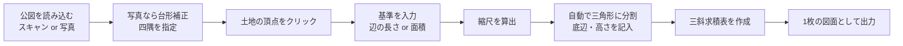

# 構想たたき台: ざっくり地積（仮称）— 公図画像から概算の三斜求積図を作るアプリ

| 作成日 | 作成者 | 状態 | 名称 |
|--------|--------|------|------|
| 2026-11-21 | 田中孝宗 | 構想段階（フィードバック募集中） | 【想定】仮称（正式名称は要件定義で確定） |

> ⚠ この資料は思いつき段階のたたき台です。【想定】は作成者の仮置き、【要確認】は未確定事項を示します。
> サービス名は**仮称**です。良い案があれば差し替えてください。

## 1. 一言でいうと

公図のスキャン画像やスマホ写真から、**「この辺は○m」または「面積は○㎡」**という手がかりをもとに縮尺を割り出します。そのうえで三斜法（土地を三角形に分け、底辺×高さ÷2を足し合わせて面積を出す方法）による**概算の求積図と計算表**を、1枚の図面として出力するアプリです。

名前の「ざっくり」には、**正式な地積測量図ではなく概算の参考図**であることが、名前を見ただけで伝わるようにするねらいがあります。

## 2. 背景・課題

- **現状**: 税理士法人の業務では、土地の評価などで公図を見て、土地のおおよその形・寸法・面積をつかみたい場面があります。
- **困りごと**: 公図には寸法が書かれていません。そのため、定規を当てて縮尺を推定したり、三角形に分けて手計算したりする必要があります。手間がかかるうえ、人によってやり方がばらつきます。
- **ねらい**: 法務局で地積測量図を取り寄せなくても、手元にある情報（公図のコピー、登記簿の面積、分かっている辺の長さなど）だけで参考図面を作れるようにします。
- **影響**: 下調べに時間がかかります。また、計算の過程が残らないため、あとから第三者が確認しにくくなります。

【想定】具体的な業務場面（相続税の土地評価の下調べ、顧問先からの相談対応など）は、利用者への確認で具体化します。

## 3. 提案するアイデア

### 仕組み（なぜそうなるか）

- **辺の長さから縮尺を出す場合**: 画像上の長さ（ピクセル数）と実際の長さ（m）の比が、そのまま縮尺になります。
- **面積から縮尺を出す場合**: 長さが2倍になると面積は4倍になります。そのため、縮尺は **√（実際の面積 ÷ 画像上の面積）** で求めます。
- **写真の台形補正**: 斜めから撮った写真では、遠い側が小さく写り、場所によって縮尺が変わってしまいます。そこで、用紙の四隅を指定して、真上から見た形に直してから計測します。
- **前提**: 1枚の公図の中では縮尺が一定だとみなします（【想定】）。ただし、紙の伸び縮みなどで縦と横の縮尺が違う場合に備え、基準が足りるときは縦横別々の縮尺も扱います。
- **縦横別の縮尺に必要な材料**: 向きの違う辺の長さが2本以上あることが目安です。面積を加えると検算ができます【推測】。必要な本数と配置の条件は、要件定義で確かめます。

## 4. 想定ユーザーと利用シーン

- **利用者**: 税理士法人の職員（土地評価の担当者など）【想定】
- **シーン**: 顧問先の土地について、手元には公図のコピーと登記簿の地積しかないとします。担当者は公図をスマホで撮影してアプリに取り込み、土地の頂点を順にタップします。次に登記簿の面積を入力すると、各辺のおおよその長さと三斜の計算表が入った図面ができます。これを社内の検討資料に添付します。

## 5. 主要機能の候補

| 機能 | 概要 | 優先度（ラフ） |
|------|------|----------------|
| 画像の読み込み | スキャン画像・写真（JPEG/PNG）。PDFの公図にも対応【想定】 | 核 |
| 台形補正 | 写真の四隅を指定し、真上から見た形に直す | 核 |
| 頂点の指定 | 土地の角をクリックやタップで指定し、あとから微調整できる | 核 |
| 縮尺の算出 | 辺の長さ、または面積のどちらかを基準にする | 核 |
| 三角形への自動分割 | 頂点から三角形を自動で作る。手での修正もできる | 核 |
| 寸法の記入 | 各辺の長さ、三斜の底辺・高さを図面に描き込む | 核 |
| 三斜求積表 | 番号・底辺・高さ・倍面積・合計・面積を表にする | 核 |
| 1枚の図面として出力 | 図と表をA4やA3の1枚にまとめ、PDFまたは印刷で出力する。顧問先に見せられる「現況図（概算）」の体裁にする | 核 |
| 複数の基準 | 辺の長さ・面積を複数入れられる。基準ごとの縮尺と食い違いを一覧で表示する | 核 |
| 縦横別の縮尺 | 基準が足りる場合だけ、縦と横で別々の縮尺を推定できる。足りない場合は「推定できない」と表示し、縦横共通の縮尺を使う | 核 |
| 面積の併記 | 「公簿面積（登記簿の面積）」を主とし、「概算面積（このアプリの計算結果）」を並べて表示する。差は参考として示す | 核 |
| 作業内容の保存・再開 | 頂点や基準を保存し、あとで続きから作業できる | あれば |
| 複数の筆をまとめて扱う | 隣り合う土地を一度に求積する | 将来 |

## 6. 実現方式の選択肢

| 案 | 概要 | 良い点 | 気になる点 | ざっくり規模感 |
|----|------|--------|-----------|----------------|
| 松: サーバー付きWebアプリ | 案件ごとの保存、kintoneとの連携、複数人での共有 | 事務所内で履歴を共有できる | 顧客の土地情報がサーバーに残る。認証や管理が必要 | 数週間〜【想定】 |
| **竹: ブラウザだけで動く単体のHTMLアプリ（おすすめ）** | 画像の処理も計算もブラウザ内で完結させ、印刷機能でPDFにする | 画像が外部に出ない。配布が簡単。Pagesなどでも動く | 保存は端末内に限られる（ファイルへの書き出しで補う） | 数日〜2週間【想定】 |
| 梅: 既存ツール＋Excelのひな形 | CAD・画像ソフトで計測し、Excelの三斜表に転記する | 開発しなくてよい | 手間とばらつきが今と変わらない | 即日 |

## 7. 期待効果とリスク・懸念

- **期待効果**
  - 下調べの時間を短縮できます。1件あたり数十分かかっていた作業が数分になる見込みです（【想定】）。
  - 計算の過程が表に残るため、検算やほかの人への説明がしやすくなります。
- **リスク・懸念**
  - **公図そのものの精度**: 古い公図は形や縮尺が実際とずれていることがあります。基準にする辺によって結果が変わります。そのため、図面には「どの基準で計算したか」を必ず記載します。
  - **写真の歪み**: 台形補正では、紙のたわみやレンズの歪みまでは直せません。スキャン画像より精度が落ちます。
  - **誤解のリスク**: 「地積測量図」は登記で使う正式な書類の名前です。この図面は申請には使いませんが、現況図として顧問先に見せる可能性があります。そのため、図面の題名は「現況図（概算）」などとし、「公図から推定した概算であり、測量の成果ではない」ことと、使った基準を図面上に明記します。
  - **情報の扱い**: 顧問先の土地情報を扱います。竹案のように外部へ送らない構成が無難です（【想定】）。

## 8. フィードバックをもらいたい点

構想段階の問いには、すべて回答をいただきました。残っている論点は、11章で要件定義に引き継ぎます。

1. （回答済み）縮尺のまとめ方 → 案A（最小二乗法）に決定。決定ログを参照
2. （回答済み）登記簿の面積と概算面積の扱い → 決定ログを参照

## 補助メモ（requirements-definition への申し送り）

### 初回価値と重大な行き止まり
- **最初の成果**: 公図を1枚読み込み、頂点と基準を1つ入れるだけで、求積表付きの図面が出ること。
- **到達を妨げる前提**: 写真に用紙の四隅が写っていないと、台形補正ができません。その場合の代わりの手段（公図上の4点を指定するなど）は【要確認】。
- **中断・復帰**: ブラウザを閉じたときに作業内容を残すかどうかは【要確認】。

### ルール交差
| 分類A | 分類B | 未決の扱い |
|-------|-------|-----------|
| 画像の種類（スキャン／写真） | 台形補正 | スキャン画像でも補正を任意で使えるようにするか【要確認】 |
| 基準の種類（辺／面積） | 基準の数（1つ／複数） | 複数の基準が食い違ったときの採用方法（8章の1）【要確認】。食い違いが大きいときに警告するかも【要確認】 |

## 9. 未確定事項と次のステップ

- 【要確認】出力の用紙サイズ（A4／A3）と、現況図に入れる項目（所在・地番・作成日・作成者・事務所名・注意書き・採用した基準など）
- 【要確認】長さと面積の端数処理（cm単位・小数第2位など）
- 【要確認】凹んだ形（凹多角形）の土地を自動で分割するときのルール
- 【要確認】正式名称
- **次のステップ**: フィードバックを反映 → 要件定義（requirements-definition）へ

## 10. 決定ログ（追記専用）

| 決定日 | 項目 | 判断 | 理由 | 再検討の条件 |
|--------|------|------|------|--------------|
| 2026-11-21 | 主な用途 | 勤務先（税理士法人）の業務で使う | 発案者の回答 | — |
| 2026-11-21 | 三角形への分け方 | 頂点を指定すると自動で分割する方式を採用。手での修正は補助として残す | 手間が最も少ない | 実務の三斜の切り方と合わないという声が出たら |
| 2026-11-21 | 写真への対応 | 対応する（台形補正あり） | 発案者の回答 | — |
| 2026-11-21 | サービス名 | 仮称「ざっくり地積」（他案: サンシャット／公図かんたん求積） | 概算であることが名前で伝わるため | 要件定義で再確認 |
| 2026-11-21 | 図面の利用範囲 | 現況図として顧問先に見せる可能性がある。登記などの申請には使わない | 発案者の回答 | 申請用途の要望が出たら（その場合は測量士・土地家屋調査士の領域になる） |
| 2026-11-21 | 複数の基準 | 入力できるようにする（「あれば」→「核」） | 発案者の回答 | — |
| 2026-11-21 | 縦横別の縮尺 | 必要に応じて扱えるようにする。材料（2方向の辺の長さ、面積など）を増やせば推定できる設計にし、情報が足りない場合は推定しない | 発案者の回答 | — |
| 2026-11-21 | 面積の表記 | 公簿面積（登記簿の面積）を優先し、概算面積は参考として並べる | メジャーでの測量には誤差が出る。地籍調査が終わった地域の図面の面積は正しいため | — |
| 2026-11-21 | 縮尺のまとめ方 | 案A: 長い辺ほど重視してまとめる（最小二乗法）。面積は検算に使う | 画像上の測り間違いの影響が小さく、結果が安定するため | 実データで結果が安定しなかった場合 |
| 2026-11-21 | 構想のねらい | 法務局で地積測量図を取り寄せずに、手元の情報から参考図面を作る | 発案者の説明 | — |
| 2026-11-21 | 複数筆の一括求積 | 将来案として保留 | 初期版は1筆での成立を優先する | 1筆の流れが安定したら |

## 11. 要件定義への引継ぎ

| 種別 | 項目 | 状態 | 次工程 |
|------|------|------|--------|
| 名称 | 「ざっくり地積」 | 【想定】仮称 | 要件定義で正式名称を再確認 |
| 用途 | 税理士法人の業務で使う | 確定 | 要件定義 |
| 入力 | スキャン画像と写真の両方に対応し、写真は台形補正する | 確定 | 要件定義 |
| 分割方式 | 頂点の指定から自動で分割する（手での修正あり） | 確定 | 要件定義 |
| 縮尺の基準 | 辺の長さ、または面積 | 確定 | 要件定義 |
| 実現方式 | ブラウザだけで動く単体のHTMLアプリ | 【想定】 | 要件定義 |
| 図面の利用範囲 | 現況図として顧問先に見せる可能性あり。申請用ではない | 確定 | 要件定義（注意書きと体裁） |
| 複数の基準 | 入力できるようにする | 確定 | 要件定義 |
| 縮尺の決め方 | 複数の基準のまとめ方は案A（最小二乗法） | 確定 | 要件定義 |
| 縦横別の縮尺 | 必要に応じて扱う。情報が足りなければ推定しない | 確定 | 要件定義（推定に必要な基準の条件を決める） |
| 面積の表記 | 公簿面積を主、概算面積を参考として併記する | 確定 | 要件定義（表記の名前と、面積を縮尺の基準にしたときの表示を決める） |
| 地籍調査済みの扱い | 地籍調査済みの土地では面積の基準を重く扱うか | 【要確認】 | 要件定義 |
| 端数・用紙 | 端数処理、用紙サイズ、図面に入れる項目 | 【要確認】 | 要件定義 |
